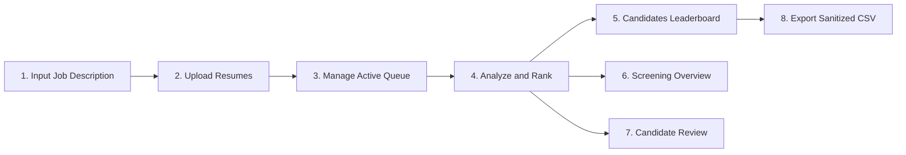

# AI Resume Screening System

An AI-assisted decision-support resume screening and candidate ranking application. The system combines Natural Language Processing (TF-IDF vectorization and Cosine Similarity), boundary-aware skill taxonomy extraction, and a multi-tier contextual evidence engine to score, explain, and rank candidate resumes against job descriptions.

---

## 🌐 Live Deployments & Repository

| Resource | URL | Description |
|---|---|---|
| **Live Screening Application (Streamlit)** | [https://ai-resume-screening-systems.streamlit.app/?page=Candidates](https://ai-resume-screening-systems.streamlit.app/?page=Candidates) | 3-Page ATS Recruiter Workspace (Screening Queue, Overview, Candidate Review) |
| **Live Product Landing Page (Vercel)** | [https://ai-resume-screening-system-nu.vercel.app/](https://ai-resume-screening-system-nu.vercel.app/) | React + TypeScript + Vite showcase and feature overview |
| **Source Code Repository** | [https://github.com/kmsenthildeepak/AI-Resume-Screening-System](https://github.com/kmsenthildeepak/AI-Resume-Screening-System) | Official GitHub repository |

---

## 📌 Problem Statement & Objectives

### The Problem
Recruiting teams frequently receive large volumes of resumes for each open requisition. Manually reading, parsing, and comparing resumes across inconsistent document formats (PDF, DOCX, TXT) is time-consuming, prone to reviewer fatigue, and susceptible to cognitive bias.

### Project Objectives
1. **Multi-Format Ingestion**: Extract structured text from **PDF, DOCX, and TXT** documents with robust error handling and malformed-file resilience.
2. **Job Description Parsing**: Identify Job Titles, Required Competencies, and Preferred / Bonus Qualifications from unstructured job postings.
3. **Pure-Python NLP & Similarity Engine**: Compute deterministic TF-IDF unigram/bigram vectors and cosine similarities without compiled native binary extensions, ensuring portability across restricted Windows environments and cloud runtimes.
4. **Contextual Skill Evidence Layer**: Detect whether matched skills appear in professional work experience with measurable metrics, project summaries, or merely unverified skills inventories.
5. **Deterministic Scoring & Identifier Removal**: Rank candidates with bounded scores \([0.0\%, 100.0\%]\) and multi-key tie-breaking, ensuring demographic identifiers (names, emails, phones, filenames) do not alter candidate relevance scores.
6. **Decision-Support Workspace**: Multi-page recruiter interface featuring active screening queues, individual resume removal controls, overview analytics, deep-dive candidate dossiers, accessible raw text inspection, and sanitized CSV exports.

> **Responsible AI Notice:** This system is an assistive decision-support tool. It does **not** make autonomous hiring decisions, does **not** automatically reject applicants, and strips non-job-related personal identifiers before text vectorization. A human recruiter must review all candidates and contextual evidence.

---

## 🔄 User Workflow



1. **Job Description Setup**: Paste job requirements or click **Load Sample Job Description** (Java Full Stack Developer template). Minimum requirement: 30 characters.
2. **Resume Upload & Queue Management**: Upload candidate resumes (PDF, DOCX, TXT, up to 10 MB per file). View active documents with formatted file sizes. Remove individual resumes or clear the queue at any time.
3. **Screening & Vectorization**: Click **Analyze & Rank Candidates** (or evaluate prebuilt demo sample candidates). The engine parses documents, strips PII from TF-IDF inputs, extracts skills, computes similarities, and establishes rankings.
4. **Candidate Leaderboard**: Inspect ranked candidates with overall score, TF-IDF textual similarity, skill match percentage, matched skills, and missing requirements.
5. **Screening Overview**: Review aggregate metrics including total evaluated, parsing success rate, average match score, score tier distribution, and required competency coverage.
6. **Candidate Review Workspace**: Select any candidate to inspect their profile dossier, contact information, education/experience mentions, contextual evidence quotes, and full raw extracted text in a high-contrast viewer.
7. **Secure CSV Export**: Export the screening leaderboard as a sanitized CSV report protected against spreadsheet formula injection.

---

## 🏗️ System Architecture

The application is structured into three integrated tiers: a high-performance React frontend, a dedicated FastAPI REST service, and a comprehensive Streamlit ATS screening workspace, all sharing a single pure-Python matching core.

```
AI-Resume-Screening-System/
├── frontend/ (React 19 + TypeScript + Vite + Tailwind CSS + Motion)
│   ├── src/components/screening-workspace.tsx # Live interactive screening workspace
│   ├── src/components/hero-parallax-demo.tsx   # Aceternity UI parallax showcase
│   ├── src/services/api.ts                    # Typed API client (VITE_API_BASE_URL)
│   └── Hosted on Vercel: https://ai-resume-screening-system-nu.vercel.app/
│
├── api.py (FastAPI REST Backend Service)
│   ├── /health                                # Health check endpoint
│   ├── /api/sample-jd                         # Sample job description template
│   ├── POST /api/screen                       # Multipart resume ingestion & scoring
│   ├── GET /api/screening/{id}                # Session retrieval (in-memory + .sessions/ disk cache)
│   └── GET /api/screening/{id}/export         # Sanitized CSV report export
│
└── Python Screening Core (Pure-Python NLP + Streamlit ATS)
    ├── app.py                   # 3-Page ATS Recruiter Workspace (Streamlit)
    ├── resume_parser.py         # Multi-format document extraction (PDF, DOCX, TXT)
    ├── requirement_extractor.py # Skill taxonomy matching & evidence classification
    ├── matcher.py               # Deterministic TF-IDF vectorizer & cosine scoring
    ├── exporter.py              # Sanitized CSV report generation
    └── config.py                # Weights, file thresholds, and 70+ skill catalog
```

### Component Architecture

| Component | Technology | Role & Functionality |
|---|---|---|
| **Interactive Frontend** | React 19, TypeScript, Vite, Tailwind CSS, Motion | Live interactive screening workspace + hero parallax hosted on Vercel |
| **Backend REST API** | FastAPI, Uvicorn, Python-Multipart | Stateless/cached REST endpoints for parsing, matching, and CSV export |
| **Streamlit ATS Workspace** | Python 3.11, Streamlit 1.35+ | 3-Page ATS interface (Candidates, Screening Overview, Candidate Review) |
| **Document Parsers** | `pypdf`, `python-docx`, Python Standard Library | Resilient binary extractors with malformed document detection |
| **Document Identity** | `hashlib` (SHA-256) | Stable content hashing (`{filename}_{hash[:16]}`) distinguishing same-named files |
| **NLP & Scoring** | Custom Pure-Python Vectorizer, Cosine Math | Unigram/bigram tokenization, TF-IDF calculation, cosine similarity |
| **Taxonomy Extractor** | Boundary-Aware Regex Pattern Matcher | Case-insensitive skill matching with strict boundaries (`C++`, `C#`, `R`, `Go`) |
| **Evidence Engine** | Section & Metric Regex Classifier | Multi-tier evidence categorization (`Impact`, `Experience`, `Project`, `Skills List`) |
| **Export Subsystem** | Standard `csv` | Formula-injection mitigated (`=`, `+`, `-`, `@`, `\t`, `\r`), UTF-8 encoded |

---

## 📐 Scoring Methodology & Mathematical Model

The scoring engine calculates a bounded composite match score between **0.0% and 100.0%** for each successfully parsed resume.

### 1. Composite Score

$$\text{Overall Score} = \left(W_{\text{text}} \times S_{\text{text}}\right) + \left(W_{\text{skill}} \times S_{\text{skill}}\right)$$

- **Default Configuration:**
  - $W_{\text{text}} = 0.65$ (65% weight on TF-IDF textual similarity)
  - $W_{\text{skill}} = 0.35$ (35% weight on explicit skill taxonomy overlap)
- **Weight Normalization & Safety:** Weights are normalized such that $W_{\text{text}} + W_{\text{skill}} = 1.0$. Invalid weights (negative, NaN, infinite, or zero sum) automatically fall back to safe defaults ($0.65 / 0.35$).

### 2. Skill Overlap Calculation ($S_{\text{skill}}$)

Job descriptions are parsed into **Required Skills** ($R$) and **Preferred Skills** ($P$):

- **When both Required and Preferred skills exist:**
  $$S_{\text{skill}} = W_{\text{req}} \times \left(\frac{|\text{Matched}_R|}{|R|}\right) + W_{\text{pref}} \times \left(\frac{|\text{Matched}_P|}{|P|}\right)$$
  *(Default: $W_{\text{req}} = 0.80$ and $W_{\text{pref}} = 0.20$)*
- **When only Required skills exist:**
  $$S_{\text{skill}} = \frac{|\text{Matched}_R|}{|R|}$$
- **When only Preferred skills exist:**
  $$S_{\text{skill}} = \frac{|\text{Matched}_P|}{|P|}$$
  *(Candidates never receive unearned credit for an empty required skills section).*
- **When no cataloged skills exist in the Job Description:**
  The system falls back to 100% TF-IDF textual similarity ($S_{\text{skill}} = S_{\text{text}}$).

### 3. Deterministic Multi-Key Tie Breaking

Candidates with identical overall scores are deterministically ranked using a stable tuple key:
1. `overall_score` (descending)
2. `matched_required_count` (descending)
3. `text_similarity_score` (descending)
4. `candidate_name` (case-insensitive ascending)
5. `candidate_id` (lexicographical ascending)

Failed or malformed resumes receive an overall score of `0.0%` and are positioned at the bottom of the leaderboard with clear error diagnostics.

> **Important Interpretation Notice:** The overall match score is an indicator of **lexical and syntactic alignment** with the written job description. It does **not** represent a statistical probability of candidate job success, competence, or hiring probability. Human review is mandatory.

---

## 🔍 Contextual Evidence Engine & Fairness Limitations

### Evidence Tiers (Explanatory Layer)

To help recruiters detect keyword stuffing and audit claims, matched skills are classified into **Evidence Tiers**:

| Tier | Badge | Criteria & Definition |
|---|---|---|
| **Impact** | 🏆 `Impact` | Skill appears in work experience alongside quantifiable metrics (e.g. `25%`, `$1.2M`, `10x`, `500k`) or strong impact verbs (`optimized`, `scaled`, `reduced`, `delivered`). |
| **Work Experience** | ⚡ `Experience` | Skill appears within professional work experience history without specific quantifiable numbers. |
| **Project** | 🛠️ `Project` | Skill demonstrated in portfolio projects, capstones, or open-source repositories. |
| **Skills List** | 📋 `Skills List` | Skill occurs exclusively in a summary skills inventory or comma-separated list. Flagged with a warning. |
| **Mention Only** | ⚠️ `Mention` | Skill appears casually in general body text without identifiable section context. |

> **Audit Context Notice:** Evidence tiers, snippet quotes, and Evidence Coverage percentages are strictly **explanatory and qualitative**. They provide recruiters with verifiable context to audit resume claims, but do **not** modify the mathematical ranking score.

### Fairness & Anti-Bias Implementation
1. **PII Stripping for Matching**: Candidate names, email addresses, phone numbers, and filenames are stripped from text prior to TF-IDF vectorization. Regression tests verify that modifying non-job-related personal identifiers (name, email, phone, filename) does not alter the TF-IDF or skill match scores for otherwise identical resume text.
2. **Protected Attribute Exclusion**: Demographic attributes (race, gender, age, nationality, marital status) are neither collected nor scored.
3. **Fairness Limitations**: Lexical matching cannot verify the veracity of claimed qualifications or evaluate non-traditional career paths. TF-IDF vectorization favors resumes that mirror the specific phrasing of the job description. Recruiters should treat scores as initial organization aids rather than definitive evaluations.

---

## 📂 Project Directory Structure

```text
AI_Resume_Screening_System/
├── app.py                         # Streamlit 3-page recruiter workspace
├── resume_parser.py               # Multi-format document parser (PDF, DOCX, TXT)
├── requirement_extractor.py       # JD parser, skill taxonomy, and evidence extractor
├── matcher.py                     # Pure-Python TF-IDF vectorizer, cosine similarity & ranking
├── exporter.py                    # Sanitized CSV generation with formula-injection guard
├── config.py                      # System constants, weights, and skill taxonomy catalog
├── requirements.txt               # Tested Python dependencies
├── pytest.ini                     # Pytest configuration
├── assets/                        # Brand assets (logo, favicon)
├── frontend/                      # React + TypeScript landing page application
│   ├── src/                       # Components, styles, and hero showcase
│   ├── package.json               # Frontend dependencies (React 19, Vite, Tailwind CSS)
│   ├── vite.config.ts             # Vite build configuration
│   └── tsconfig.json              # TypeScript compiler configuration
├── sample_resumes/                # Synthetic test resumes for demonstration
│   ├── resume_01_strong_match.txt
│   ├── resume_02_partial_match.docx
│   ├── resume_03_unrelated.txt
│   ├── resume_04_python_dev.pdf
│   └── data_scientist_test/       # 8 specialized test resumes for batch testing
├── tests/                         # Automated test suite (95 tests)
│   ├── test_evidence.py                  # Skill evidence tiers and warnings (5 tests)
│   ├── test_fairness.py                  # PII stripping and demographic neutrality (5 tests)
│   ├── test_integration.py               # Streamlit workflows, queue, and navigation (28 tests)
│   ├── test_matcher.py                   # Pure-Python TF-IDF, scoring math, tie-breaking (12 tests)
│   ├── test_queue_removal.py             # Queue synchronization, removal, and edge cases (12 tests)
│   ├── test_requirement_extractor.py     # JD sections, skill boundary matching (14 tests)
│   ├── test_resume_parser.py             # PDF, DOCX, TXT parsers & entity extraction (15 tests)
│   └── test_validation.py                # CSV sanitization, formula safety, Unicode (4 tests)
└── docs/                          # Architecture specifications and documentation
```

---

## 🚀 Setup & Execution Guide (Windows / PowerShell)

### Prerequisites
- **Operating System:** Windows 10 / 11 (or macOS / Linux)
- **Python:** 3.11+
- **Node.js:** 18+ (for running the React frontend)
- **Git**

---

### Option 1: Running the FastAPI Backend & React Frontend (Recommended)

#### Terminal 1 — Start the FastAPI Backend Service

```powershell
# 1. Navigate to project root
cd AI-Resume-Screening-System

# 2. Activate virtual environment
Set-ExecutionPolicy -Scope Process -ExecutionPolicy Bypass
.\.venv\Scripts\Activate.ps1

# 3. Install dependencies (including FastAPI & Uvicorn)
pip install -r requirements.txt

# 4. Start the FastAPI backend on port 8000
python -m uvicorn api:app --reload --port 8000
```
Backend API will be live at `http://localhost:8000` (interactive Swagger docs at `http://localhost:8000/docs`).

#### Terminal 2 — Start the React Interactive Frontend

```powershell
# 1. Navigate to frontend directory
cd AI-Resume-Screening-System\frontend

# 2. Install dependencies
npm install

# 3. Start the Vite dev server
npm run dev
```
Interactive React application will be live at `http://localhost:5173`.

---

### Option 2: Running the Streamlit Multi-Page ATS Workspace

```powershell
# Navigate to project root and launch Streamlit
cd AI-Resume-Screening-System
.\.venv\Scripts\Activate.ps1
streamlit run app.py
```
The Streamlit application will be available at `http://localhost:8501`.

---

## ☁️ Deployment Architecture & Configuration

| Service | Recommended Host | Configuration Variables |
|---|---|---|
| **React Frontend** | [Vercel](https://vercel.com/) | `VITE_API_BASE_URL` (points to deployed FastAPI URL)<br>`VITE_STREAMLIT_URL` (points to Streamlit app) |
| **FastAPI Backend** | [Render](https://render.com/) / [Railway](https://railway.app/) / Cloud Run | `CORS_ORIGINS` (comma-separated allowed origins, e.g. `https://ai-resume-screening-system-nu.vercel.app`) |
| **Streamlit Workspace** | [Streamlit Community Cloud](https://streamlit.io/cloud) | Built-in GitHub deployment |

---

## 🧪 Automated Testing & Verification

The project includes an automated test suite comprising **108 verified tests** across 9 test modules.

Run the test suite using the activated virtual environment or direct executable path:

```powershell
# Using the active virtual environment
pytest

# Or direct invocation via virtual environment python
.\.venv\Scripts\python.exe -m pytest
```

### Test Suite Breakdown

| Test Module | Tests | Scope & Assertions |
|---|:---:|---|
| [`tests/test_api.py`](tests/test_api.py) | 13 | Health check, validation errors, multi-candidate ranking, session caching, 404 handling, CSV export, corrupted document resilience, TTL eviction, 4 sample resumes regression, empty files validation, cross-process disk fallback, path traversal prevention, expired session handling |
| [`tests/test_evidence.py`](tests/test_evidence.py) | 5 | Evidence tiers (`Impact`, `Experience`, `Project`), quantifiable metric detection, unverified skills warnings |
| [`tests/test_fairness.py`](tests/test_fairness.py) | 5 | PII stripping invariance, demographic neutrality, tie-breaking determinism, vocabulary preservation |
| [`tests/test_integration.py`](tests/test_integration.py) | 28 | Recruiter workflows, multipage state synchronization, queue retention across navigation, 12-candidate rendering |
| [`tests/test_matcher.py`](tests/test_matcher.py) | 12 | Pure-Python TF-IDF, cosine similarity, weight normalization, deterministic ranking, edge-case scores |
| [`tests/test_queue_removal.py`](tests/test_queue_removal.py) | 12 | Uploader widget drops, UI removal expander, multi-rerun stability, same-filename collision handling, state reset |
| [`tests/test_requirement_extractor.py`](tests/test_requirement_extractor.py) | 14 | Boundary-aware matching (`C++`, `C#`, `R`, `Go`, `.NET`), alias normalization, JD section segmentation |
| [`tests/test_resume_parser.py`](tests/test_resume_parser.py) | 15 | PDF, DOCX, and TXT extraction, malformed document handling, size limit enforcement, contact info parsing |
| [`tests/test_validation.py`](tests/test_validation.py) | 4 | CSV formula injection mitigation (`=`, `+`, `-`, `@`, `\t`, `\r`), non-dangerous whitespace preservation, UTF-8 safety |
| **Total Verified** | **108** | **All passing** |

---

## 🔒 Security & Privacy Safeguards

1. **Formula Injection Sanitization**: All exported CSV values beginning with spreadsheet calculation triggers (`=`, `+`, `-`, `@`, `\t`, `\r`) are escaped with a leading single quote (`'`), while non-dangerous ordinary whitespace is preserved.
2. **Local In-Memory Processing**: Resumes are parsed, vectorized, and scored entirely in local memory. No candidate documents, contact details, or resume contents are transmitted to external third-party APIs.
3. **Application Control (WDAC) Compliance**: The TF-IDF vectorizer and ranking engine run on standard library Python data structures and pure-Python math, avoiding hard dependencies on external C-extension binary DLLs that are blocked by corporate endpoint security policies.
4. **Input Sanitization**: HTML entities in candidate names, filenames, and evidence quotes are escaped with `html.escape()` before rendering to prevent Cross-Site Scripting (XSS).

---

## ⚠️ Known Limitations & Future Improvements

### Current Limitations
- **Scanned Document OCR**: Image-only PDFs (scanned documents without embedded text layers) are not parsed by the standard text extractor.
- **Fixed Skill Catalog**: Skill matching relies on an internal dictionary of 70+ industry skills and aliases. Uncataloged niche or proprietary tools rely solely on TF-IDF textual similarity.
- **Lexical Matching**: TF-IDF and keyword matching evaluate lexical co-occurrence; they do not assess semantic depth, project quality, or candidate problem-solving ability.

### Future Roadmap
- [ ] Optical Character Recognition (OCR) integration via Tesseract for scanned PDF support.
- [ ] Integration with open-source sentence transformers (e.g., `all-MiniLM-L6-v2`) for hybrid dense-lexical retrieval.
- [ ] Integration with standardized competency ontologies (e.g., O*NET, ESCO).
- [ ] Batch export to JSON / ATS webhook payloads for integration with enterprise platforms (Workday, Greenhouse).

---

## 📄 License

This repository does not currently include a formal open-source license file. All rights are reserved by the repository owner unless otherwise noted.
