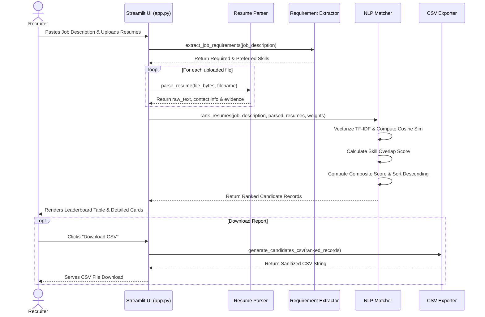

# System Architecture & Technical Design: AI Resume Screening System

This document outlines the software engineering architecture, component boundaries, data pipelines, and design patterns implemented in the **AI Resume Screening System**.

---

## 🏛️ High-Level System Architecture

```text
┌────────────────────────────────────────────────────────────────────────┐
│                        Streamlit Presentation Layer                     │
│    (app.py - Web Dashboard, Weight Sliders, File Uploaders, Tables)     │
└───────────────────────────────────┬────────────────────────────────────┘
                                    │ Invokes
                                    ▼
┌────────────────────────────────────────────────────────────────────────┐
│                        Application Logic Layer                         │
├──────────────────────────┬─────────────────────────┬───────────────────┤
│    Document Parsing      │  Requirement Extraction │   NLP Matcher     │
│   (resume_parser.py)     │ (requirement_extractor) │   (matcher.py)    │
│                          │                         │                   │
│ • pypdf Engine           │ • Regex Boundary Match  │ • TfidfVectorizer │
│ • python-docx Engine     │ • Skill Taxonomy Dict   │ • NumPy Cosine    │
│ • TXT Multi-encoding     │ • Section Segmentation  │ • Score Composite │
│ • Entity & Regex Heur    │ • Education & Exp Heur  │ • Rank Ordering   │
└──────────────────────────┴─────────────────────────┴───────────────────┘
                                    │ Generates
                                    ▼
┌────────────────────────────────────────────────────────────────────────┐
│                      Export & Security Layer                           │
│                          (exporter.py)                                 │
│ • CSV Formula Injection Sanitization (=, +, -, @, \t escape)            │
│ • UTF-8 CSV Stream Generation via Standard Library                     │
└────────────────────────────────────────────────────────────────────────┘
```

---

## 🧩 Module Breakdown & Responsibilities

### 1. `config.py` (Configuration & Taxonomies)
- **File Limits:** Configures `MAX_FILE_SIZE_MB = 10` and `SUPPORTED_EXTENSIONS = {".pdf", ".docx", ".txt"}`.
- **Default Weights:** Establishes `DEFAULT_WEIGHT_TEXT_SIMILARITY = 0.65` and `DEFAULT_WEIGHT_SKILL_MATCH = 0.35`.
- **Competency Taxonomy:** A dictionary mapping 40+ canonical tech and soft skills to over 150 synonyms and aliases (e.g., `Scikit-Learn` -> `["sklearn", "scikit learn", "scikit-learn"]`).
- **Inverted Alias Index:** Pre-indexes aliases to canonical terms for $O(1)$ lookups.

### 2. `resume_parser.py` (Multi-Format Document Parsing)
- **Format Handlers:** Dispatches byte arrays to `extract_text_from_pdf`, `extract_text_from_docx`, or `extract_text_from_txt`.
- **Defensive Error Trapping:** Converts corrupted binaries, password-protected PDFs, and non-UTF text files into user-friendly diagnostic messages without crashing.
- **Entity Extraction:** 
  - Standardized regex patterns for emails (`EMAIL_REGEX`) and telephone numbers (`PHONE_REGEX`).
  - Heuristic candidate name identification based on early-line scanning and alphabetic token validation.
  - Regex-driven education and experience snippet harvesting.

### 3. `requirement_extractor.py` (Competency Extraction)
- **Boundary Preservation:** Uses word boundary regexes (`\b`) and special character wrappers for technical terms like `C++`, `C#`, and `.NET`.
- **False-Positive Prevention:** Strictly avoids matching short tokens like `Go` or `R` within common prose words like `algorithm`, `good`, or `read`.
- **Section Parsing:** Segregates job descriptions into `required` versus `preferred` buckets based on industry header conventions.

### 4. `matcher.py` (NLP & Scoring Engine)
- **Scikit-Learn TF-IDF:** Uses `TfidfVectorizer` configured with English stop-word filtering and unigram/bigram tokenization.
- **Pure NumPy Cosine Similarity:**
  $$\cos(\mathbf{u}, \mathbf{v}) = \frac{\mathbf{u} \cdot \mathbf{v}}{\|\mathbf{u}\|_2 \|\mathbf{v}\|_2}$$
  Implemented via pure NumPy vector operations to eliminate dependencies on C-extension libraries blocked by Windows WDAC.
- **Score Composition:** Combines normalized TF-IDF textual similarity with skill overlap ratios.
- **Deterministic Rank Ordering:** Sorts candidates descending by composite score, tie-breaking by textual similarity and unique candidate ID.

### 5. `exporter.py` (Sanitized Export)
- **Formula Injection Mitigation:** Inspects each exported cell value. If the first character matches spreadsheet executable triggers (`=`, `+`, `-`, `@`, `\t`, `\r`), an apostrophe (`'`) is prepended to neutralize formula execution.
- **Universal Compatibility:** Uses Python's native `csv` writer with UTF-8 encoding.

---

## 🔄 Data Flow Sequence Diagram


